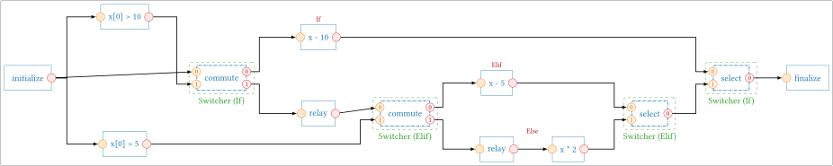
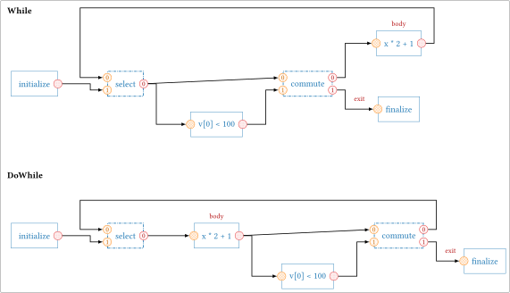

# Branches and loops

A sequence executes its tasks in a fixed order. To take one path or another, or to
repeat a part of the graph, StreamPU provides control flow structures, described with
`with` statements, like Python code:

| Structure | Python equivalent |
|-----------|-------------------|
| `spu.If(condition, x)`, followed by `spu.Elif(condition)` and `spu.Else()` | `if` / `elif` / `else` |
| `spu.Switch(ctrl, x)`, with `Case` and `Default` blocks | `match` / `case` / `case _` |
| `spu.For(n, x)` | `for _ in range(n)` |
| `spu.While(condition, x)` | `while condition(x):` |
| `spu.DoWhile(condition, x)` | a body executed once, then while `condition(x)` is true |

Each structure works on one or several **variables** (`x`, or `x, y`…), which are sockets.
In a block (an `If` block, a `Case` block, the body of a loop…), `x` designates the value of
the variable in this block. After the structure, `x` designates its value at the exit of the
structure.

```python
import streampu as spu
```

## If, Elif and Else

```python
x = spu.array([8, 8, 8, 8], dtype=spu.int32)

with spu.If(x[0] > 10, x) as b:
    b.value = x - 10
with spu.Elif(x[0] > 5) as b:
    b.value = x - 5
with spu.Else() as b:
    b.value = x * 2

print(x)  # [[3 3 3 3]]: 8 - 5
```

- `spu.If` takes the condition and the variable. It can be followed by any number of
  `spu.Elif` blocks and one `spu.Else` block, **at the same level and right after it**, as in
  Python.
- `b.value = ...` gives the value of the variable at the end of the block. It must be
  computed from the variable, in the block. A block that does not give it leaves the
  variable unchanged, as well as the missing `Else`. The in-place operators also give it:
  `x += 1` in a block is the same as `b.value = x + 1`.
- A condition holds **one value per frame**, `0` for false and any other value for true
  (here `x[0] > 10`, the first element of `x`; `spu.any(...)` and `spu.all(...)` reduce a
  whole socket). The condition of an `Elif` is computed from the value of the variable
  **before the `If`**, as in Python, although `x` designates the value after the chain
  once the `If` block is closed.

Each `If` and `Elif` builds a `Switcher` with two paths (see
[below](#under-the-hood-the-switcher)): the path 0 is the block, taken when the condition is
true; the path 1 leads to the next `Elif`, to the `Else` block, or leaves the variable
unchanged:

<figure markdown="span">
  
  <figcaption>The graph built by the example above. The relayers start the path 1 of each Switcher.</figcaption>
</figure>

## Switch, Case and Default

`spu.Switch(ctrl, x)` takes the path whose `Case` contains the value of `ctrl`, an integer
socket with one value per frame:

```python
mode = spu.array([2], dtype=spu.int32)
x = spu.array([10, 10, 10, 10], dtype=spu.int32)

with spu.Switch(mode, x) as sw:
    with sw.Case(0):
        sw.value = x + 1
    with sw.Case(1, 2):          # several values for the same path
        sw.value = x * 2
    with sw.Default():           # when no case matches (optional)
        sw.value = x - 1

print(x)  # [[20 20 20 20]]
```

The rules of `If` apply: `sw.value = ...` gives the value at the end of a path, and
without `Default`, a value that matches no case leaves the variable unchanged. A `Switch`
builds a single `Switcher`, with one path per `Case` and one for `Default`.

## For

`spu.For(n, x)` executes its body `n` times. In the body, `x` designates the value of the
variable at the current iteration, and `loop.next = ...` gives its value at the next one
(an in-place operator such as `x += 1` also gives it):

```python
x = spu.array([0, 0, 0, 0], dtype=spu.int32)
inc = spu.incrementer(4, dtype=spu.int32)

with spu.For(10, x) as loop:
    loop.next = inc.increment(x)

print(x)  # [[10 10 10 10]]
```

## While and DoWhile

`spu.While(condition, x)` executes its body while the condition is true.
`spu.DoWhile(condition, x)` executes it once, then again while the condition is true. As for
`For`, `x` designates the value of the variable in the body, and `loop.next = ...` (or an
in-place operator) gives its value at the next iteration:

```python
x = spu.array([5, 5, 5, 5], dtype=spu.int32)

with spu.While(lambda v: v[0] < 100, x) as loop:
    loop.next = x * 2 + 1

print(x)  # [[191 191 191 191]]: 5, 11, 23, 47, 95, 191
```

The condition is a **function of the variable**, here `lambda v: v[0] < 100`: the loop calls
it on the value of the variable at the right place of the graph, so that the condition is
computed again at each iteration. Written directly (`spu.While(x[0] < 100, x)`), it would be
computed once, before the loop: this raises an error. The function returns one value per
frame, `0` for false.

The two loops differ by the place of the test: before the body for `While` (the body may
not be executed at all), after the body for `DoWhile` (on the value that the body gives):

<figure markdown="span">
  
  <figcaption>The graphs built by <code>spu.While</code> and <code>spu.DoWhile</code> for the condition <code>v[0] &lt; 100</code> and the body <code>x * 2 + 1</code>.</figcaption>
</figure>

A condition that never becomes false makes the execution of the sequence never end. Give
`max_iter` to stop the loop after a given number of iterations in any case:

```python
x = spu.array([0, 0, 0, 0], dtype=spu.int32)

with spu.While(lambda v: v[0] < 100, x, max_iter=3):
    x += 1

print(x)  # [[3 3 3 3]]: stopped by max_iter
```

The count starts again at each execution of the loop. When the loop stops because of
`max_iter`, nothing signals it: compare the variable with the condition after the loop if
needed.

## Several variables

All the structures take several variables, of any types and sizes: give them after the
condition (or the control, or the number of iterations). In a block, each one designates
its value in the block; give the new values as a tuple, in the same order (`b.value = (...)`,
`loop.next = (...)`), or modify them with in-place operators. A variable that is not
modified keeps its value. The condition of a `While` or a `DoWhile` receives all the
variables:

```python
x = spu.array([0, 0, 0, 0], dtype=spu.int32)
y = spu.array([1.0, 1.0], dtype=spu.float64)

with spu.While(lambda a, b: a[0] < 10, x, y):
    x += 3
    y *= 2.0

with spu.If(x[0] > 10, x, y) as b:
    b.value = (x - 10, y + 0.5)

print(x, y)  # [[2 2 2 2]] [[16.5 16.5]]
```

The variables are gathered into one socket of bytes before the structure, which commutes it
as a single variable, and scattered in each block and after the structure (the modules
`Gatherer` and `Scatterer`, see [below](#under-the-hood-the-switcher)): this costs a copy of
the variables at each of these steps.

## Nesting the structures

All the structures can be nested: an `If` in a loop, a loop in an `If` block, a `Switch`
in a `Case`… This loop applies the Collatz step until the value reaches 1 (`x / 2` is an
integer division on integers):

```python
x = spu.array([6, 6, 6, 6], dtype=spu.int32)

with spu.While(lambda v: v[0] != 1, x, max_iter=1000) as loop:
    with spu.If((x[0] & 1) == 0, x) as b:   # even
        b.value = x / 2
    with spu.Else() as b:
        b.value = x * 3 + 1
    loop.next = x

print(x)  # [[1 1 1 1]]: 6, 3, 10, 5, 16, 8, 4, 2, 1
```

An `Elif` or an `Else` continues the `If` of its own block: in a nested block, a new chain
starts with a new `If`.

## Immediate mode and sequences

As the tasks, the structures can be executed immediately or be part of a graph:

- with `spu.Task.call_auto_exec = True` (the default), the structure is **executed at the end
  of its `with` block** (of the outermost one, for nested structures; of each block, for an
  `If` chain), with the tasks that compute its inputs: they are executed again, so beware of
  the sources that read a file. Inside the block, the tasks are only described: printing a
  socket there shows no meaningful value;
- in a [`with spu.sequence()` block](../tutorial/sequence.md#describe-the-sequence-in-a-with-block),
  a [`with spu.stage()` block](../tutorial/parallelism.md#describe-the-pipeline-stage-by-stage)
  or with `spu.Task.call_auto_exec = False`, the structure is part of the graph, and is
  executed at each execution of the sequence or of the pipeline:

```python
ini = spu.initializer(4, dtype=spu.int32)
fin = spu.finalizer(4, dtype=spu.int32)

with spu.sequence(n_threads=4) as seq:
    x = ini.initialize()
    with spu.If(x[0] > 10, x) as b:
        b.value = x - 10
    fin.finalize(x)

ini.data_init[0][:] = 15
seq.exec_seq()
print(fin.final_data[0])  # [5, 5, 5, 5]
```

## Limitations

- **The tasks of a block have to use the variable of the block**: StreamPU executes a task
  of a path only if it depends on the value commuted into this path. A task that only uses
  values computed before (e.g. `inc.increment(y)` where `y` is computed before the `If`)
  would be executed in any case: it raises an error. The constants (`x * 2`) are allowed.
- **`Elif` and `Else` follow the previous block directly**: a task that uses `x` between two
  blocks of a chain uses the value before the chain (it is treated as a part of the next
  condition).
- **Endless loops**: a `While` or a `DoWhile` whose condition stays true never ends, and
  `Ctrl+C` only stops a sequence between two executions: give `max_iter`.
- **One path for all the frames**: with [`n_frames`](../tutorial/sequence.md#process-several-frames-at-once)
  frames per execution, the path is chosen from the condition (or the control) of the
  **first frame**, and all the frames take it: in a `While`, all the frames make the same
  number of iterations.

## Under the hood: the Switcher

The structures are built with the modules below, which can also be bound by hand:

| Module | Role |
|--------|------|
| `spu.Switcher` | its task `commute` sends the data to one of several paths, its task `select` takes the data of the path that was executed |
| `spu.Controller_static`, `spu.Controller_cyclic`, `spu.Controller_limit` | output the index of the path to take |
| `spu.Iterator` | outputs `0` for a given number of executions, then `1`: it controls a loop |
| `spu._ext.gat.Gatherer`, `spu._ext.gat.Scatterer` | gather several sockets into one socket of bytes, and scatter it back: they let a structure handle several variables with one `Switcher` |

The examples of this section use small `initializer` / `incrementer` / `finalizer` chains,
described in a [`with spu.sequence()` block](../tutorial/sequence.md#describe-the-sequence-in-a-with-block).

### Exclusive paths

A `Switcher` has two tasks:

- `commute(in_data, in_ctrl)` copies `in_data` to **one** of its outputs `out_data0`,
  `out_data1`…, the one whose index is given by `in_ctrl`;
- `select(in_data0, in_data1, ...)` outputs the data of the path that was executed.

Only the tasks of the chosen path are executed: the sequence skips the others.

<figure markdown="span">
  
  <figcaption>Two exclusive paths: path 0 adds 1, path 1 adds 2. The controller alternates between them.</figcaption>
</figure>

```python
import streampu as spu

N = 4
ini = spu.initializer(N, dtype=spu.int32)
ctl = spu.Controller_cyclic(2)          # 0, 1, 0, 1...
sw = spu.Switcher(2, N, spu.int32)      # 2 paths, data of N int32
incs = [spu.incrementer(N, dtype=spu.int32) for _ in range(3)]
fin = spu.finalizer(N, dtype=spu.int32)

with spu.sequence() as seq:
    data = ini.initialize()
    ctl.control.bind(data)              # execute the controller after the initializer
    path0, path1 = sw.commute(data, ctl.control())
    a = incs[0].increment(path0)                    # path 0: + 1
    b = incs[2].increment(incs[1].increment(path1)) # path 1: + 2
    fin.finalize(sw.select(a, b))

ini.data_init[0][:] = 1
for _ in range(4):
    seq.exec_seq()
    print(fin.final_data[0])
```

```text
[2, 2, 2, 2]
[3, 3, 3, 3]
[2, 2, 2, 2]
[3, 3, 3, 3]
```

`ctl.control.bind(data)` makes the controller depend on the initializer (see
[`Task.bind`](../tutorial/parallelism.md#dependencies-without-data)). Without it, the
controller would have no input and would be a first task of the sequence, executed
before the data exist.

The controllers differ by the path they output at each execution:

| Controller | Paths |
|------------|-------|
| `spu.Controller_static(path)` | always `path` (it can be changed between two executions with `ctl.path = ...`) |
| `spu.Controller_cyclic(n_paths, init_path=0)` | `init_path`, `init_path + 1`, … modulo `n_paths` |
| `spu.Controller_limit(limit, init_path=0)` | `init_path` for the first `limit` executions, then the other path |

The control socket `in_ctrl` is an `spu.int8` socket of one element: the output of a
controller, of an `Iterator`, or of any task of the graph with the same type.

The paths of a `Switcher` all have the same size and data type. A `Switcher` whose
commuted and selected data differ is built with
`spu.Switcher(n_paths, n_elmts_commute, dtype_commute, n_elmts_select, dtype_select)`.

!!! warning
    With a sequence built by `spu.Sequence(first_task)`, do not create constants inside a
    path (`path1 * 10` creates an `Array.read` task for `10`): build the sequence from its
    output socket (`spu.Sequence(out)`), or describe it in a `with spu.sequence()` block,
    which handle them.

### A loop

A loop is a `Switcher` whose `select` takes either the data entering the loop or the
data coming back from the body of the loop, and whose `commute` sends the data either
to the body of the loop or out of it. An `Iterator` drives `commute`: it outputs `0`
(stay in the loop) `limit` times, then `1` (leave the loop), and starts again.

<figure markdown="span">
  
  <figcaption>A loop that executes its body 3 times. The output of the body goes back to the input 0 of <code>select</code>.</figcaption>
</figure>

```python
N = 4
ini = spu.initializer(N, dtype=spu.int32)
sw = spu.Switcher(2, N, spu.int32)
it = spu.Iterator(3)                     # 3 iterations
inc = spu.incrementer(N, dtype=spu.int32)
fin = spu.finalizer(N, dtype=spu.int32)

with spu.sequence() as loop:
    x = ini.initialize()
    it.iterate.bind(sw.select)           # count after each select
    body, done = sw.commute(sw["select::out_data"], it.iterate())
    y = inc.increment(body)              # body of the loop
    sw.select(y, x)                      # input 0: back from the body, input 1: entering the loop
    fin.finalize(done)

ini.data_init[0][:] = 0
loop.exec_seq()
print(fin.final_data[0])                 # [3, 3, 3, 3]
```

Two points are specific to loops:

- `sw.select(y, x)` is called **after** the body, because `y` is computed by the body.
  Its output is used before, by `sw.commute(sw["select::out_data"], ...)`: the socket is
  reached by its name, since `select` has not been called yet;
- `select` is executed at each turn of the loop, and `it.iterate.bind(sw.select)` makes the
  iterator count after it.

A *do-while* loop, whose body is executed before the test, puts the body between
`select` and `commute`: see `tests/bootstrap/test_do_while_loop.py`.

## A sequence as a single task

`spu.Set` wraps a sequence into a module with one task, `exec`. The sub-sequence can then
be reused as a block in another sequence. Its first task gives the input socket `in` of
`exec`, its last task the output socket `out`:

```python
incs = [spu.incrementer(N, dtype=spu.int32) for _ in range(3)]
with spu.sequence() as sub:              # the sub-sequence: three incrementers
    y = incs[0].increment()
    for inc in incs[1:]:
        y = inc.increment(y)
three = spu.Set(sub.sequence)

ini = spu.initializer(N, dtype=spu.int32)
fin = spu.finalizer(N, dtype=spu.int32)
with spu.sequence() as main:
    fin.finalize(three.exec(ini.initialize()))

ini.data_init[0][:] = 5
main.exec_seq()
print(fin.final_data[0])                 # [8, 8, 8, 8]
```

A `Set` is cloned like any other module when the sequence runs on several threads.

## Iterating in Python with `Range`

`spu.Range(stop, start=0, step=1, dtype=spu.int32)` outputs `start`, `start + step`… up to
`stop` (excluded), one value per execution of its task `iterate`. It is also a Python
iterator, which executes the task at each step:

```python
>>> [int(s.numpy[0][0]) for s in spu.Range(5, start=1, step=2)]
[1, 3]
```

When the range is exhausted, the next execution raises `StopIteration` (which ends a
Python `for` loop). With `rng.throw_to_stop = False`, it outputs the last value again with
its output `flg` set to `1`, then starts over from `start`.
